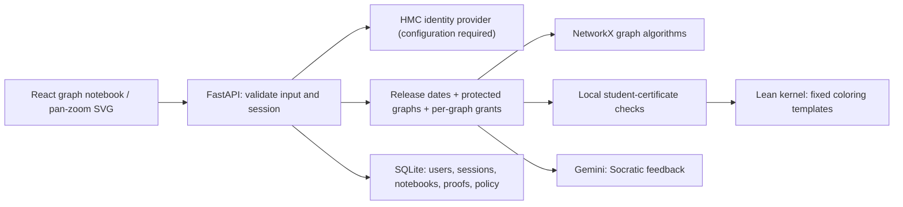

# Septimatica implementation

The original plan is preserved in `backend/backend_hierarchy.txt`. The existing
graph/coloring/planarity/layout modules remain available as a Python library.
`backend/server.py` now exposes only the authenticated application in `backend/web.py`;
the old globally shared, unauthenticated graph endpoints have been removed.

## Boundaries

- Browser: rendering and editing only. Camera movement does not change graph topology.
  API responses for stale graph revisions are discarded. React escapes tutor text.
- Models: explicit isolates, unique integer IDs, finite coordinates, simple undirected
  edges; bounded inputs before expensive computation. Topology hashes exclude positions.
- Policy: authorization happens again on the server for every analysis request.
  No client checkbox or Gemini verdict can grant access. Protection survives relabeling.
- Algorithms: deterministic NetworkX tests and bounded exact coloring. Heuristic
  coloring never claims a chromatic number without a matching certified lower bound.
- Evidence: Python validates graph certificates; Lean independently checks coloring
  edges/upper bounds. Written reasoning is reviewed by Gemini informally or instructors.
- Auth: signed short-lived OIDC transaction cookie, random opaque application-session
  cookie, hashed session tokens in SQLite, eight-hour expiry, HttpOnly/SameSite cookies,
  Secure in production, no CORS, same-origin custom-header requirement for mutations.
- Secrets: server environment only. No school passwords are stored. SSO tokens are
  discarded after identity verification. Gemini receives graph/messages, not identity.

## Known scope limits

General natural-language proof formalization is not implemented: automatic translation
can formalize the wrong statement, and running arbitrary Lean code is unsafe. This
version intentionally certifies only fixed supported statements. Graph persistence is
manual-save; undo/redo and chat history are browser-memory only. One course policy is
supported per installation. Multi-course rosters, accessibility-equivalent keyboard
graph construction, shared notebooks and other discrete math subjects are future work.
